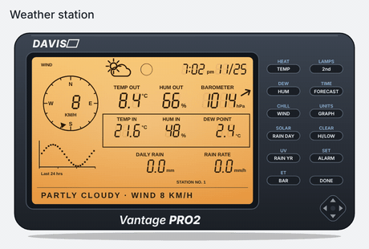

# Weather station (Davis Vantage Pro2 style)

<p align="center"></p>

`custom:appliance-weather-station-card`: a weather station console in the style of the Davis Vantage Pro2, fully drawn in SVG, with its backlit LCD redrawn live.

- **Compass rose** with the wind direction (pointer on the ring) and the wind speed in the centre.
- **Forecast icon** (sun, clouds, rain, snow, storm, fog), **moon phase** (computed from the date), **time and date**.
- **Fixed area**: outdoor temperature and humidity, **barometer** with a **5-position trend arrow** over 3 hours (needs `entity_pressure`).
- **Variable area**: indoor temperature and humidity, and an **extra value** of your choice (`entity_extra` + `extra_label`: heat index, dew point, UV, solar radiation…).
- **Daily rain** and **rain rate**, with the **umbrella** shown when it rains.
- **24 h graph** of a sensor (`entity_graph`, outdoor temperature by default) and the **ticker** at the bottom (`entity_ticker`, or the forecast translated by Home Assistant and the wind).
- `backlight: false` for the grey, unlit LCD. The LCD labels (TEMP OUT, BAROMETER…) stay in English like on the real console; change them with `labels`.

Sources: a `weather.*` entity (local station or web weather) and / or separate sensors, all optional. A separate sensor wins over the attribute of the weather entity.

```yaml
type: custom:appliance-weather-station-card
name: Weather station
entity_weather: weather.home
entity_temp_out: sensor.outdoor_temperature     # optional
entity_pressure: sensor.outdoor_pressure        # optional (trend arrow)
entity_temp_in: sensor.living_room_temperature
entity_hum_in: sensor.living_room_humidity
entity_extra: sensor.dew_point
extra_label: Dew point
entity_rain_day: sensor.rain_today
entity_rain_rate: sensor.rain_rate
```

[← All cards](../../README.md#the-cards)
