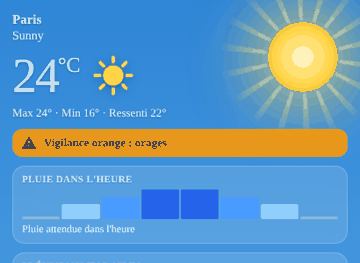

# Animated weather

<p align="center"></p>

`custom:appliance-weather-card`: a complete weather card from a single `weather.*` entity, on an **animated scene** that follows the condition and the day / night.

- **Animated sky**: sun with turning rays, moon and twinkling stars, drifting clouds, rain and heavy rain, snow, hail, storm with lightning flashes, fog, wind streaks. Day or night comes from `sun.sun` (or is calculated from your position).
- **Now**: temperature, condition (translated by Home Assistant), high / low of the day and feels-like.
- **Alert banner** (`entity_alert`): a `binary_sensor` (shown when `on`, text = its name or `headline` / `event` attribute) or a `sensor` such as the Météo-France weather alert (hidden when green / off).
- **Rain in the next hour** (`entity_next_rain`): bars for the Météo-France *next rain* sensor (`1_hour_forecast`).
- **Hourly forecast** (`hourly_count`, 12 by default) and **daily forecast** (`daily_count`, 5 by default) with icons, rain probability and a min / max bar, from `weather.get_forecasts`.
- **Details**: wind with a direction arrow and gusts, humidity and dew point, UV index (attribute or `entity_uv`), pressure, visibility, cloud cover. A tile opens the more-info of the entity.
- **Sun and moon**: sunrise, sunset and length of the day, calculated for the position of Home Assistant, with the sun on its arc, and the **moon phase**.
- **Rain radar** around your home: animated RainViewer layers (last frames and, when available, the next ones) over an OpenStreetMap base map (no API key needed; inverted automatically in dark theme), with a marker on your home, play / pause and a timeline. Needs internet access from the browser. `radar_zoom` (3 to 7), `radar_height`, `radar_color` (RainViewer scheme 1 to 8), `latitude` / `longitude` to look elsewhere.
- Each block can be hidden: `show_alert`, `show_next_rain`, `show_hourly`, `show_daily`, `show_details`, `show_sun`, `show_radar`. `animations: false` freezes the scene (also frozen by the system setting "reduce motion").

```yaml
type: custom:appliance-weather-card
entity: weather.home
name: Home                        # optional
entity_alert: binary_sensor.home_weather_alert   # optional
entity_next_rain: sensor.home_next_rain          # optional (Météo-France)
entity_uv: sensor.uv_index                       # optional
hourly_count: 12
daily_count: 5
radar_zoom: 7
```

[← All cards](../../README.md#the-cards)
